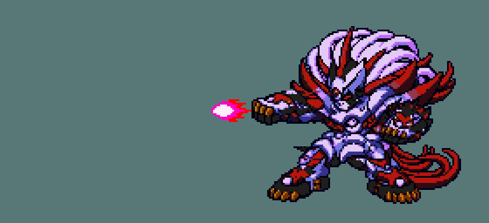

# Alternating wave punches — redesigned v001

Two reciprocal, planted short punches using approved Candidate 2 v001 as the body-size and identity reference. The video pose is deliberately abandoned. A punches with the right arm; B with the left arm across the chest. The inactive gauntlet is chambered near the ribs. Head, mane, feet and stance share identical pixels outside the arm/chest band; the character does not bounce between drawings.

[Pose-only loop](pose-only-loop.gif) · [Approved base and both poses at equal scale](base-and-two-poses.png)

| Pose | Native PNG | Nearest 6x preview | Indexed BMP |
| --- | --- | --- | --- |
| A: right punch | [PNG](A-right-punch-1x.png) | [Preview](A-right-punch-6x.png) | [BMP](A-right-punch.bmp) |
| B: left punch | [PNG](B-left-punch-1x.png) | [Preview](B-left-punch-6x.png) | [BMP](B-left-punch.bmp) |

Both body canvases are 144×112, indexed with the exact approved 16-entry palette and opaque teal RGB(88,120,120). Actual used colour counts and occupied bounds are in specification.json. Character frames contain no effects. The [separate transparent energy projectile](chi-wave-1x.png) travels away from each gauntlet in the preview. It has its own 3-colour FX palette. The preview uses only two body drawings; extra GIF ticks move the projectile rather than create new body poses. Emission anchors and adjustable timing are documented in specification.json.

Art route: built-in image_gen. Repository pixel-looks ask-view/view with approved master as left-hand grid ruler; strict ruler matches 88.48% and 79.58%, warnings=[] for both. Source dimensions 1774×887; generated cells measured on the master lattice, then palette locked to the original without resizing native cells. Integer registration and a shared-body arm/chest-band composite reduce flicker. This is a custom pose use of ask-view, not a video-generated motion extraction. FX uses pixel_look master, measured 23×13 cells, proportions=blocks; no repeated rows. Its original blocks are rectangular, so the native FX is slightly flatter than the generated picture.

No automatic artistic approval is claimed. Two poses snap directly without wind-up or recovery in-betweens; the GIF illustrates a rapid repeating attack. No game-import compatibility claim. Original base, older attempts and references remain unchanged. Generated sources and extraction records are retained in processing/. Uploaded videos are not included.

Final checks: both body frames use 15 of the original 16 stored palette entries (unused green excluded from foreground mapping). No green-key residue is intentionally retained. Lineup verdict=same; no warnings. Lineup height112 includes opaque teal canvas, so it is not a body-height measurement; actual occupied bounds are recorded separately. GIF decoded frames were verified against intended compositions pixel-for-pixel.
