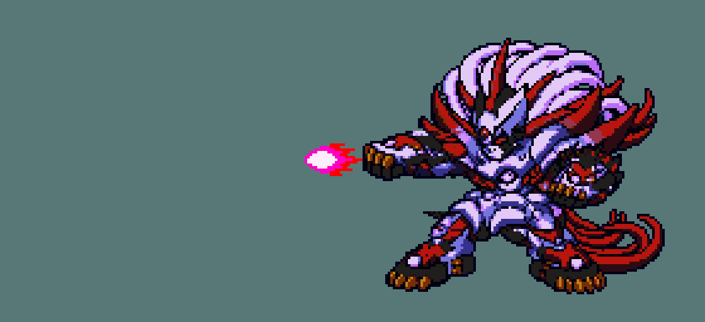

# Option 2 — right arm chambered back during left punch

Option 1 remains the user-accepted final option, unchanged in `../v001/`. This alternative changes only the inactive right arm in the left-punch drawing: raised, bent and pulled back beside the ribs instead of hanging down. The left punch, head, body, proportions, legs, feet and hair retain the exact pixels of option 1 outside the documented inactive-arm box. The right-punch frame and separate projectile are copied byte-for-byte from option 1.

[Pose-only loop](pose-only-loop.gif) · [Base and both options side by side](option-comparison.png)

- [Left punch with right arm back — native PNG](B-left-punch-right-arm-back-1x.png) · [6x](B-left-punch-right-arm-back-6x.png) · [BMP](B-left-punch-right-arm-back.bmp)
- [Unchanged right punch — native PNG](A-right-punch-1x.png) · [6x](A-right-punch-6x.png)

144×112; exact original 16-entry indexed palette, 15 entries used, opaque teal RGB(88,120,120). Nearest-neighbour previews. Exactly two character drawings; energy wave travels separately. Same preview timing as option 1: 200ms per body pose, 40ms projectile ticks. Built-in image_gen edit followed by repository pixel-looks ask-pose/pose on option 1's lattice. Strict source/master match 89.8%; extractor retained 93.06% master cells. Final composition additionally locks every pixel outside inactive-arm box x30..65/y40..76 to option 1. No fallback pipeline used. Numeric checks do not replace visual approval. No game-import compatibility claim.

Generated source, request and extraction records retained in processing/. Earlier options and original references are preserved.

Lineup verdict: same; measured body height100 rows for both transparent inputs, no first-drawing differences flagged. No warnings returned. Final native B has occupied height102 including horns.
