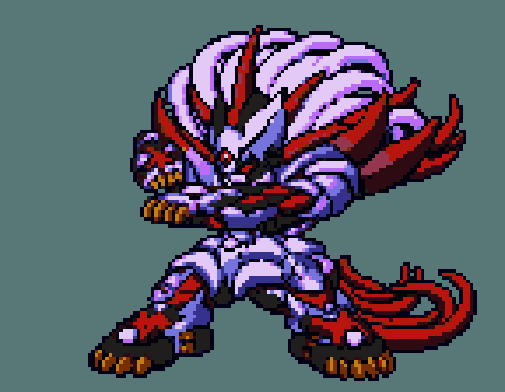

# Selected first image — alternating left/right punch loop

**Approved by the user on 2026-11-23.** Saved as the accepted alternating left/right punch loop. Final option 1 remains preserved separately.

Uses the first image explicitly reattached by the user (generated source exec-885e0b6d), not subsequent shortened-punch attempts. A reciprocal right punch was generated from that image, exchanging the arms without mirroring the character. The selected longer left reach is deliberately retained; no claim that it matches the superseded20% target.

[Slow inspection loop](alternating-loop-slow.gif) · [Both poses](two-poses.png)

| Pose | Native PNG | 6x nearest preview | Indexed BMP |
| --- | --- | --- | --- |
| Selected left punch | [PNG](left-punch-1x.png) | [Preview](left-punch-6x.png) | [BMP](left-punch.bmp) |
| Right punch | [PNG](right-punch-1x.png) | [Preview](right-punch-6x.png) | [BMP](right-punch.bmp) |

Exactly two body frames, 144×112, original16-entry palette,15 colours used, opaque teal RGB(88,120,120). No energy or effects in this motion preview. Normal180ms/pose; slow350ms/pose. All enlargements nearest-neighbour. Head, mane, waist/lower body and feet share fixed pixels outside rows38..78; shoulder/arm/chest overlap changes with each punch.

Art route: built-in image_gen; repository pixel-looks ask-pose/pose extraction on approved option1 lattice. Strict master match79.14% (left),76.44% (right), retained master81.89% and79.79%. Generated pictures are sampled on measured grid, then mapped to approved palette without rescaling cells. Pose extraction retains master cells outside detected changes, so native sprites are processed derivatives rather than literal downscales of source images. Reciprocal drawing uses selected image as design reference; extractor still registers to original option1 master. No fallback route. Numeric QA does not approve anatomy. Two drawings snap directly between punches; no recovery in-betweens or interpolation are claimed.

Final option1 and all previous revisions remain untouched. No game import compatibility claim. Generated source pictures, requests and extraction records retained in processing/.

Lineup verdict=same, body height100 rows for master and both transparent extractions; no firstDrawingDiffers or warnings returned. GIF decoded pixels verified against intended nearest-neighbour frames.
