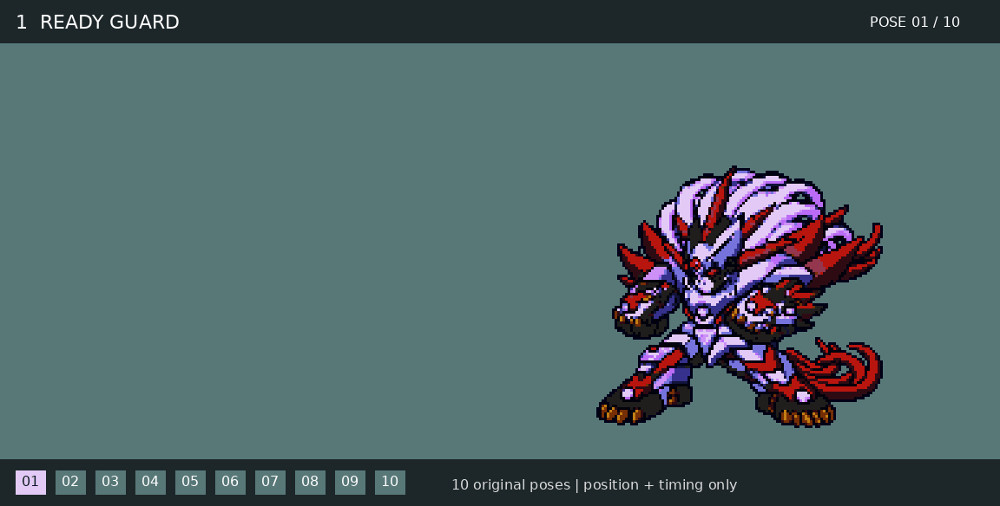

# Ten-pose moveset demonstration

Uses the amended v002 sprites unchanged: guard/powerup → low dash and close/rising strikes → launch and airborne pursuit → landing/palm windup → palm finish. Whole-sprite translation, jump height, repeated close-strike poses and held anticipation show how the ten drawings can represent the video move.

[Slow demonstration](moveset-demonstration-slow.gif) · [Overview](motion-overview.png) · [Source sprites](../../v002/README.md)

No added character drawings, opponent, aura, beam, hit flash or scenery. The original ten native PNGs are unchanged, including red-eye lock and angular armour. Stage is384×160 logical pixels displayed3x nearest-neighbour; each mecha frame stays144×112 at1x. Labels and the numbered pose indicator are outside the stage. Whole sprite positions move in integer pixels; poses snap rather than morph. The last-to-first loop is a deliberate replay reset, not a claimed seamless recovery.

Compressed demonstration timing, not a literal44-second/60fps recreation. Only the existing ten poses are used; close/rising strikes reuse04/05 to indicate the rapid combo. Position and timing values are in timeline.json. Original source hashes recorded and checked unchanged. GIF readback was verified over every encoded time interval. Earlier v002 height review flags remain documented in the source set; no new anatomy approval or game-import compatibility claim.
