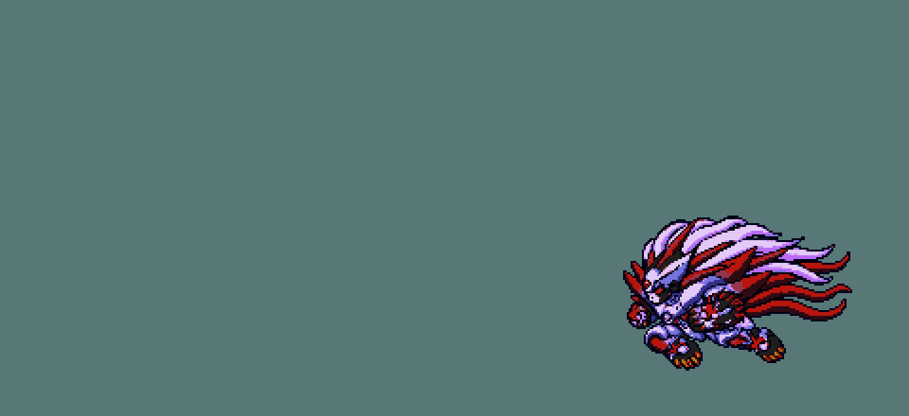

# Impact flow v002 — articulated-hand revision

Draft for visual review. Corrected after the rigid shield/capsule hands in the previous unpublished draft were rejected. The visual authority is the user's previously approved punches, uppercut and palm artwork: closed fingers form gold-tipped knuckles; an open palm has actual articulated digits. Forearm armour stays behind the wrist. Hand-like articulation is allowed. Supporting kick legs use the retained kick's segmented knee/shin/ankle/foot structure.

[Slow clean GIF](moveset-30-slow.gif) · [Approved/revised comparison](approved-and-revised.png) · [All30 poses](all-30-poses.png) · [30 individual native PNGs](mecha-30-native-only.zip) · [PNG/previews/BMP bundle](mecha-30-individual-sprites.zip)

Sequence: **前方重拳 → uppercut → kick → uppercut → 左右連環拳 → 掌擊**. Two dash drawings,28 attacking drawings (including attack preparation, drive and links). No idle/power-up/neutral recovery padding. The6-pose pursuit block repeats3times; repetitions are timing uses, not extra drawings.30 distinct native drawings:23 new pose edits,5 byte-identical approved attack endpoints and2 byte-identical dash poses. The retained left-facing v8 kick keeps the same target side; the separate v10 right-facing option is preserved unchanged in its existing directory.

Every native PNG is144×112, indexed with the exact original16-entry palette and opaque teal RGB(88,120,120). Actual used colours are recorded per file in specification.json/qa-report.json;16 palette entries does not mean16 colours necessarily occur.6x previews use nearest-neighbour. Indexed BMPs included. Native sprites contain only the mecha: no target, beam, aura, hit flashes, scenery, UI or cast shadow. Original colours and red-eye design retained; occluded eyes are not painted over the forearm/jaw.

The separate [hit-reference GIF](hit-reference.gif) and [slow version](hit-reference-slow.gif) add a simple outlined TARGET box only as a motion diagram. Recoil/lift and integer pursuit offsets show the designed hit reference from the video, not a physical simulation, enemy drawing or1:1 recreation. Main GIF is clean. Heavy contacts have held impact poses; alternating airborne punches chase left with vertical variations; palm produces the largest final displacement. Normal duration and exact timing are in timeline.json. End-to-start is an inspection replay reset.

Processing uses built-in image_gen edits and repository pixel-looks ask-view/view: original approved standing ruler on left, approved action seed on right, approved articulated-hand reference board. Each generated picture is measured on the ruler's lattice and sampled to1x; no arbitrary illustration shrinking. Native cells map to the approved palette, then receive only integer canvas padding. New sources, prompts, seeds, extraction records and review images are retained under processing/. Original reference files and older versions remain unchanged. The rigid-hand v001 draft and rejected pilot remain preserved in the workspace; the manifest records them. No editor/game source or ROM changes, no paid API used. Game-import compatibility is unverified.

Visual limits: condensed pose interpretation where video effects obscure limbs; some small joint/claw details simplify on the native grid; separately generated poses can vary in projected head/mane shape. Numeric file checks are not artistic approval. All30 hand/foot constructions were inspected against approved artwork. Extended punches can obscure the lower face, and coiled/airborne projection changes measured height.

## Recorded height review

The lineup tool reports `differs` against the101-row standing master. It uses a1-row tolerance and does not recognize all angled/occluded feet reliably. Per-frame heights and exact extraction warnings are retained in qa-report.json and processing/lineup/. Warnings are not suppressed or represented as passing art approval:

- 03: the new view's body is 92 rows tall, the master's 101: it is not the same height; generate again
- 04: the new view's body is 91 rows tall, the master's 101: it is not the same height; generate again
- 06: the new view's body is 91 rows tall, the master's 101: it is not the same height; generate again
- 07: the new view's body is 97 rows tall, the master's 101: it is not the same height; generate again
- 08: the new view's body is 95 rows tall, the master's 101: it is not the same height; generate again
- 11: the new view's body is 98 rows tall, the master's 101: it is not the same height; generate again
- 12: the new view's body is 104 rows tall, the master's 101: it is not the same height; generate again
- 13: the new view's body is 98 rows tall, the master's 101: it is not the same height; generate again
- 15: the new view's body is 95 rows tall, the master's 101: it is not the same height; generate again
- 16: the new view's body is 96 rows tall, the master's 101: it is not the same height; generate again
- 17: the new view's body is 94 rows tall, the master's 101: it is not the same height; generate again
- 19: the new view's body is 94 rows tall, the master's 101: it is not the same height; generate again
- 20: the new view's body is 92 rows tall, the master's 101: it is not the same height; generate again
- 21: the new view's body is 93 rows tall, the master's 101: it is not the same height; generate again
- 22: the new view's body is 91 rows tall, the master's 101: it is not the same height; generate again
- 23: the new view's body is 97 rows tall, the master's 101: it is not the same height; generate again
- 24: the new view's body is 93 rows tall, the master's 101: it is not the same height; generate again
- 25: the new view's body is 88 rows tall, the master's 101: it is not the same height; generate again
- 26: the new view's body is 94 rows tall, the master's 101: it is not the same height; generate again
- 30: the new view's body is 95 rows tall, the master's 101: it is not the same height; generate again

Capability doctor: supplied-video decoding and host image generation available; optional API credentials, SVG renderer and video-generation route were not used. Private source clips/stills are not redistributed.
