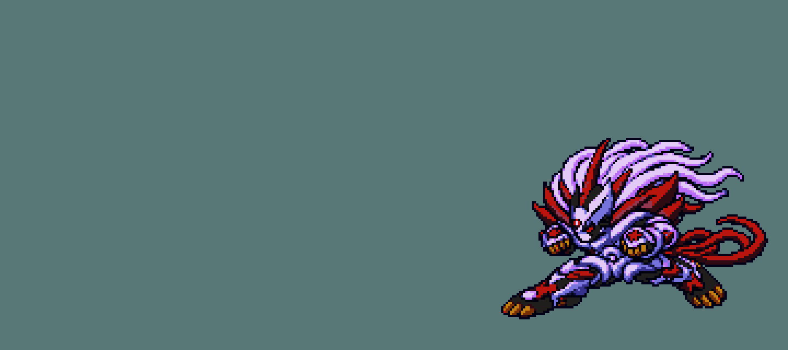

# Grounded moveset and rear-view sweep — v003

Draft for visual review. Latest correction: **Juno meant jump attack**. Removed airborne pursuit and the extra opening jab; the first heavy punch follows a low ground dash. Seven kick drawings show waist and shoulders turning to the mecha's right, exposing the left-rear body, sweeping laterally below the head and continuing through the back before landing. This replaces the front-facing high leg lift.

[Slow full moveset](moveset-30-slow.gif) · [Numbered timing view](moveset-30-labelled.gif) · [Enlarged slow rotating kick](rotating-kick-detail.gif) · [Enlarged slow palm](palm-detail.gif) · [Kick/palm comparison](kick-and-palm-comparison.png) · [All30 poses](all-30-poses.png)

[30 individual native PNG ZIP](mecha-30-native-only.zip) · [PNG/nearest previews/indexed BMP bundle](mecha-30-individual-sprites.zip)

Sequence: **前方重拳 → uppercut → rotating horizontal sweep kick → grounded uppercut → 左右連環拳 → 掌擊**.30 distinct drawings:2 dash,4 heavy punch,3 first uppercut,7 rotating kick,4 second uppercut,6 ground combination,4 palm.22 new edits and8 byte-identical retained sprites. The6-drawing combination repeats3times. There is no separate jab before the heavy punch, no jumping or airborne attack and no idle/power-up padding. The support leg stays under the rotating kick; native body drawings and GIF positions are not lifted into flight.

The palm has a clearly withdrawn open-hand coil, short hip drive, upright palm-heel impact in a planted forward lunge, then committed followthrough. The rear foot stays fixed in the motion preview. Coil440ms, drive80ms, impact280ms, follow440ms; force comes from pose contrast, waist/shoulder/leg drive and impact holds. No visual effects were added to substitute for the pose. The normal complete move is5.36s, slow10.72s; detail clips2.48s each. End-to-start is an inspection replay reset.

Native files in native/ are144×112 indexed PNGs with the exact original16-entry palette,15 colours actually used per file, opaque teal RGB(88,120,120).6x previews are exact nearest-neighbour; indexed BMPs included. Original red-eye palette retained; faces hidden by rear view/mane are not invented. Sprites contain only the mecha, no opponent, energy wave, aura, trails, flashes, dust, scenery, shadow or UI. Labels in the optional timing/review images are outside the sprites. No engine import compatibility is claimed.

Art source: built-in host image_gen, model not reported by tool; no paid API used. Existing approved base/punch/palm construction is the identity reference. Repository pixel-looks ask-view/view workflow: original standing master on left gives scale/grid; new action on right. Initial image-generation canvas2048×1024, palm references widened to2304×1024 to keep fingers out of the ruler exclusion area. These are source reference canvases only; native output remains144×112. Generated grid is measured and sampled, then mapped to the original palette and padded by whole native pixels; no arbitrary illustration shrinking, body stretching or coded redraw.7 kick poses use support-foot registration; palms use rear-foot registration; other poses use their original ground canvas origin. No vertical flight offsets or morphing.

26 image requests:22 retained drawings,3 rejected art takes and1 provider error retried successfully through the same host route. Rejected takes: swapped open-palm arm, fingers entering the ruler exclusion margin, extra clawed appendage at waist. The initially valid back-recovery drawing was reassigned to slot16; a new full-back recovery fills15. Sources, prompts, requests, native extraction reviews, rejected art and initial alignment records are preserved under processing/. Original base/reference files and all earlier versions remain unchanged. Existing editor/game/tool source code was not modified. Private supplied video and screenshots are not published.

## Quality review and limits

30 different native drawings, fixed original canvas/palette/opaque background, exact6x nearest previews and all intended time intervals in5GIFs were verified by decoding the saved GIFs back to RGB. Limb counts and silhouette/hand/foot construction were visually inspected, including the rejected extra appendage. These checks do not constitute the user's artistic approval. Hidden back armour is simplified/interpreted from the supplied left-rear screenshot and base; separately drawn rotating views can vary in projected mane/armour shape. This is a condensed pose interpretation, not1:1 video staging or60fps motion. Small bevels/claw details simplify at1x.

Palm29 initially failed ruler registration with `the picture does not show the master again: only 41 percent of its cells come back equal. Generate again (the prompt asks for the same figure in the same place)`. A larger alignment search recovers the shifted ruler, within the upstream default search window; the strict nine-point equality and60% gate are unchanged. Final match is recorded in qa-report.json. No threshold was lowered and no pipeline substitution was made.

The lineup result is **differs**, not a pass: standing master body101rows, tolerance1row. Exact per-file heights are retained in processing/lineup/ and qa-report.json. Crouched/leaned/back projections and the narrow foot-column height detector (especially25) differ from the standing column; source/native side-by-side reviews remain available. All new-source height warnings are retained verbatim below:

- 01: the new view's body is 65 rows tall, the master's 101: it is not the same height; generate again
- 02: the new view's body is 75 rows tall, the master's 101: it is not the same height; generate again
- 03: the new view's body is 92 rows tall, the master's 101: it is not the same height; generate again
- 11: the new view's body is 103 rows tall, the master's 101: it is not the same height; generate again
- 12: the new view's body is 103 rows tall, the master's 101: it is not the same height; generate again
- 13: the new view's body is 105 rows tall, the master's 101: it is not the same height; generate again
- 14: the new view's body is 103 rows tall, the master's 101: it is not the same height; generate again
- 15: the new view's body is 103 rows tall, the master's 101: it is not the same height; generate again
- 16: the new view's body is 91 rows tall, the master's 101: it is not the same height; generate again
- 18: the new view's body is 91 rows tall, the master's 101: it is not the same height; generate again
- 19: the new view's body is 91 rows tall, the master's 101: it is not the same height; generate again
- 21: the new view's body is 97 rows tall, the master's 101: it is not the same height; generate again
- 25: the new view's body is 67 rows tall, the master's 101: it is not the same height; generate again
- 26: the new view's body is 97 rows tall, the master's 101: it is not the same height; generate again
- 28: the new view's body is 98 rows tall, the master's 101: it is not the same height; generate again
- 29: the new view's body is 92 rows tall, the master's 101: it is not the same height; generate again
- 30: the new view's body is 98 rows tall, the master's 101: it is not the same height; generate again

Capability doctor: host image generation and supplied-clip decoding available. Optional API credentials, SVG renderer and video-generation route are missing and were not used. No ROM, game image or editor source modified.
