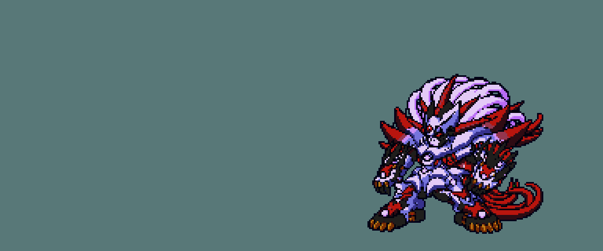

# Thirty-pose moveset — v001

30 unique144×112 sprite PNGs representing the established six-part video moveset with extra connecting drawings.10 newly generated poses and20 previously base-derived drawings (18 copied byte-for-byte,2 legacy spin-eye palettes corrected). The approved Candidate2v001 is the visual ruler and identity master. Latest long left punch with lower-face occlusion and accepted palm ending stay unchanged. Bothv008 forward kick and user-selectedv010 turning kick are included.

[Slow17.6s GIF](moveset-30-slow.gif) · [Numbered8.8s GIF](moveset-30-labelled.gif) · [All30 poses](all-30-poses.png) · [Individual PNG ZIP](mecha-30-individual-sprites.zip)

Sequence: standing/guard/power coil → dash → knee chamber → rising kick → turning kick → back-facing landing and unwind → uppercut and aerial pursuit/turn/kick → landing → six-pose left/right punch cycle repeated4times → palm settle/charge/extension/release → recovery.

Thirty distinct native drawings are used; repeated combo cycles and held frames do not count as extra drawings. Native PNGs in native/ (one pose per file),6x nearest-neighbour previews in previews/, indexed BMPs in bmp/. Original16-entry palette,15–16 actual colours per frame including opaque teal RGB(88,120,120). No opponent, energy beam, aura, hit flash, scenery or UI inside native sprites. Pixel outlines and original red eyes retained. No game-import compatibility claim.

The10 new transitions cover dash anticipation, knee chamber, back landing, unwind, uppercut preparation, left/right half strikes, palm settle, half release and recovery. Built-in image_gen uses a wide master-ruler reference; strict repository pixel-looks lattice extraction turns each measured cell into one native pixel, then original palette mapping. No illustration downscaling.21/24 align generated arms by integer translation and restore the common20 head/legs/tail outside a documented arm mask so the six-pose punch loop keeps a common body. No source-code edits or paid APIs. Original and generated sources, prompts, lattice checks and wrappers retained under processing/; previous versions remain intact. Private video frames are not redistributed.

Motion is a condensed staging interpretation of the supplied video plus the established approved kick/spin/punch choices, rather than literal44-second/60fps reproduction. Normal8.8s, slow17.6s. Stage384×160 displayed3x nearest; sprites remain144×112. Static key drawings snap without morphing; whole-sprite positions move on integer pixels.30unique drawings,4combo cycles. Finish-to-start is a deliberate inspection replay reset. Clean GIF uses the original16-entry palette; numbered GIF has extra colours only outside the stage.

All3 GIFs were decoded and matched against all176 intended time intervals. Native palette/canvas,30-pose uniqueness and exact6x preview pixels verified. Numerical checks establish file integrity, not artistic approval. This version is for review.

## Height review flags

Standing body reference101rows; lineup tolerance1row. `lineup` verdict is `differs` for crouches, kicks and airborne poses. Full per-file measurements are in processing/lineup/lineup.json and qa-report.json. The six-pose punch block20–25 is consistently92rows. Drawing height changes with pose; full camera/body continuity still needs visual review. New extraction warnings are retained verbatim below:

- 04 (native/04-dash-coil.png): the new view's body is 89 rows tall, the master's 101: it is not the same height; generate again
- 09 (native/09-back-landing.png): the new view's body is 98 rows tall, the master's 101: it is not the same height; generate again
- 11 (native/11-uppercut-coil.png): the new view's body is 96 rows tall, the master's 101: it is not the same height; generate again
- 21 (native/21-left-half-strike.png): the new view's body is 98 rows tall, the master's 101: it is not the same height; generate again
- 24 (native/24-right-half-strike.png): the new view's body is 97 rows tall, the master's 101: it is not the same height; generate again
- 28 (native/28-palm-half-release.png): the new view's body is 98 rows tall, the master's 101: it is not the same height; generate again

The doctor reports missing optional API credentials, video-generation route and SVG renderer; none is used. Host image generation and supplied-clip inspection were available.
