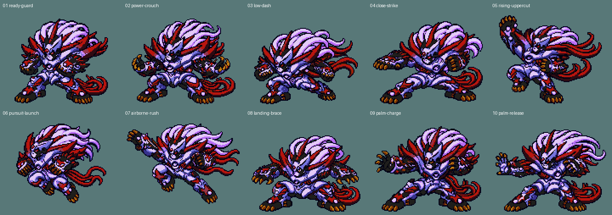

# Ten mecha key poses — video sequence v001

Draft for visual review: ten individual native sprites derived from approved Candidate2 v001, representing the supplied six-part sequence: ready guard → power crouch → low rush → close strike → rising strike → pursuit launch → airborne rush → landing brace → palm windup → final palm thrust. The six recordings total about43.7s; camera closeups, long flashes, opponent reactions and finishing explosion are omitted. Fast pursuit is frequently obscured by streaks; poses06–07 are readable reconstructions of that passage, not exact tracing of every hidden joint.

[Sequence preview](sequence-preview.gif) · [Slow inspection](sequence-slow.gif)

| Pose | Native144x112 | Nearest preview | Occupied bounds x0,y0,x1,y1 | Used colours |
| --- | --- | --- | --- | --- |
| 01 ready-guard | [PNG](native/01-ready-guard.png) | [6x](previews/01-ready-guard-6x.png) | [17, 8, 127, 109] | 15 |
| 02 power-crouch | [PNG](native/02-power-crouch.png) | [6x](previews/02-power-crouch-6x.png) | [11, 8, 133, 109] | 15 |
| 03 low-dash | [PNG](native/03-low-dash.png) | [6x](previews/03-low-dash-6x.png) | [11, 19, 133, 109] | 15 |
| 04 close-strike | [PNG](native/04-close-strike.png) | [6x](previews/04-close-strike-6x.png) | [7, 11, 136, 109] | 15 |
| 05 rising-uppercut | [PNG](native/05-rising-uppercut.png) | [6x](previews/05-rising-uppercut-6x.png) | [11, 4, 132, 109] | 15 |
| 06 pursuit-launch | [PNG](native/06-pursuit-launch.png) | [6x](previews/06-pursuit-launch-6x.png) | [19, 5, 125, 99] | 15 |
| 07 airborne-rush | [PNG](native/07-airborne-rush.png) | [6x](previews/07-airborne-rush-6x.png) | [5, 5, 138, 100] | 15 |
| 08 landing-brace | [PNG](native/08-landing-brace.png) | [6x](previews/08-landing-brace-6x.png) | [8, 19, 136, 109] | 15 |
| 09 palm-charge | [PNG](native/09-palm-charge.png) | [6x](previews/09-palm-charge-6x.png) | [9, 8, 134, 109] | 15 |
| 10 palm-release | [PNG](native/10-palm-release.png) | [6x](previews/10-palm-release-6x.png) | [7, 12, 137, 109] | 15 |

All files use the exact approved16-entry indexed palette;15 colours used, opaque teal RGB(88,120,120). Unused green entry excluded from foreground mapping. Native sprites are generated-grid cells read at1x, never a resized illustration. All previews nearest-neighbour. Individual indexed BMPs in bmp/. No opponent, energy, scenery, aura, text or screen UI in the sprites. Existing approved assets unchanged; no editor/game files modified. No game-import compatibility claim.

The preview is ten key drawings with holds, not smooth60fps animation or a literal44s recreation. Both preview GIFs loop for inspection; the attack itself is a one-shot sequence. Grounded poses share floor109; two flight poses are raised9–10px. Horizontal positioning centres each silhouette on canvas, rather than claiming a verified runtime root/collider. Native placement and timing are documented in specification.json.

## Method and provenance

Built-in image_gen, approved base as unchanged left ruler, one reposed figure per separate image on right. Repository generate2dsprite pixel-looks ask-view/view custom-pose workflow.2048x1024 request layout; returned1774x887 sources. Each source's strict ruler fit determines grid, and new figure is read on its own lattice. Narrowed fitter retains the original gate; no failed ruler was patched or bypassed. Intermediate extra shades then nearest mapping to the original palette, excluding the original green foreground entry; cells are not resized. Original anatomy, gauntlets, contours and simplified mechanical details still need visual review: a numerical gate is not artistic approval.

Every source, host prompt, request, extracted1x and source-versus-native review is retained in processing/ and comparisons/. Source videos/screenshots remain private outside the repository. References contains unchanged approved native base and original style reference.

## Height warnings — retained verbatim

The extractor compares the occupied central-column body height with a standing ruler. Crouches, leaning strikes and tucked flight poses change that measurement. These drafts retain the warnings instead of claiming all checks passed. Each must be judged at equal scale against the approved body; this set is not automatically approved.

- `native/01-ready-guard.png`: the new view's body is 99 rows tall, the master's 101: it is not the same height; generate again
- `native/03-low-dash.png`: the new view's body is 82 rows tall, the master's 101: it is not the same height; generate again
- `native/04-close-strike.png`: the new view's body is 74 rows tall, the master's 101: it is not the same height; generate again
- `native/05-rising-uppercut.png`: the new view's body is 92 rows tall, the master's 101: it is not the same height; generate again
- `native/06-pursuit-launch.png`: the new view's body is 93 rows tall, the master's 101: it is not the same height; generate again
- `native/07-airborne-rush.png`: the new view's body is 93 rows tall, the master's 101: it is not the same height; generate again
- `native/08-landing-brace.png`: the new view's body is 90 rows tall, the master's 101: it is not the same height; generate again
- `native/09-palm-charge.png`: the new view's body is 99 rows tall, the master's 101: it is not the same height; generate again
- `native/10-palm-release.png`: the new view's body is 97 rows tall, the master's 101: it is not the same height; generate again

Lineup check also returns `verdict=differs`; its `firstDrawingDiffers` list is poses01,03,04,05,06,07,08,09,10, with central-column heights99,82,74,92,93,93,90,99,97 versus standing master101. Pose02=101. Full machine-readable record is processing/lineup/lineup.json. This is a review flag, not a passed same-build assertion. All files remain drafts for visual review.
