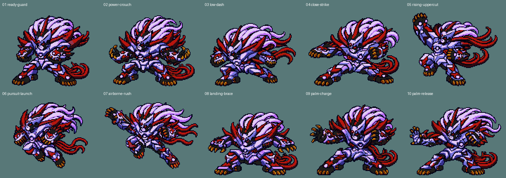

# Ten-pose amendment v002 — fixed red eyes and angular armour

Amends v001 rather than changing the action: sharpened shoulders, gauntlet shells, knee/shin plates and feet into planar bevels and wedges with dark joint gaps. Original flowing hair and round luminous components remain. The original pose face is restored, then only the documented visible-eye pixels are colour-corrected to the approved base palette: main red **RGB(184,21,14)**, shadow RGB(46,11,19), muted red RGB(148,54,78). Orange/yellow/pink/white eye highlights are excluded. Automated assertions inspect every documented eye box; face pixels outside the eye box equal v001 exactly. This restores original red identity rather than trusting model-written eye colours.

[Sequence](sequence-preview.gif) · [Slow](sequence-slow.gif) · [Eyes beside original base](red-eye-inspection.png)

| Pose | Native PNG | Nearest6x | Before/after |
| --- | --- | --- | --- |
| 01 ready-guard | [PNG](native/01-ready-guard.png) | [6x](previews/01-ready-guard-6x.png) | [Compare](comparisons/01-ready-guard-before-after.png) |
| 02 power-crouch | [PNG](native/02-power-crouch.png) | [6x](previews/02-power-crouch-6x.png) | [Compare](comparisons/02-power-crouch-before-after.png) |
| 03 low-dash | [PNG](native/03-low-dash.png) | [6x](previews/03-low-dash-6x.png) | [Compare](comparisons/03-low-dash-before-after.png) |
| 04 close-strike | [PNG](native/04-close-strike.png) | [6x](previews/04-close-strike-6x.png) | [Compare](comparisons/04-close-strike-before-after.png) |
| 05 rising-uppercut | [PNG](native/05-rising-uppercut.png) | [6x](previews/05-rising-uppercut-6x.png) | [Compare](comparisons/05-rising-uppercut-before-after.png) |
| 06 pursuit-launch | [PNG](native/06-pursuit-launch.png) | [6x](previews/06-pursuit-launch-6x.png) | [Compare](comparisons/06-pursuit-launch-before-after.png) |
| 07 airborne-rush | [PNG](native/07-airborne-rush.png) | [6x](previews/07-airborne-rush-6x.png) | [Compare](comparisons/07-airborne-rush-before-after.png) |
| 08 landing-brace | [PNG](native/08-landing-brace.png) | [6x](previews/08-landing-brace-6x.png) | [Compare](comparisons/08-landing-brace-before-after.png) |
| 09 palm-charge | [PNG](native/09-palm-charge.png) | [6x](previews/09-palm-charge-6x.png) | [Compare](comparisons/09-palm-charge-before-after.png) |
| 10 palm-release | [PNG](native/10-palm-release.png) | [6x](previews/10-palm-release-6x.png) | [Compare](comparisons/10-palm-release-before-after.png) |

144×112 indexed PNGs, exact original16-entry palette,15 used entries, opaque teal RGB(88,120,120). Indexed BMPs in bmp/. Native cells are not rescaled; registration uses the preceding pose's placement and masterAt. The source1536×1536 canvas with10px cells is an enlarged editing reference only, not a change in native output resolution. No enemy/effects; same10-drawing preview timing. v001 and approved earlier actions preserved.

Built-in image_gen edits followed by repository pixel-looks ask-pose/pose. The pose reader takes connected changed cells while retaining the master elsewhere. Strict master-gate readings recorded for every pose. Pose01 first take50% and pose09 first take57% failed and were regenerated, not bypassed. Failed sources retained. Final eye/face lock is a targeted source-pixel restoration and user-requested palette correction, not a new art pipeline. Processing requests, prompts, generated sources, extracted native sprites, before/after and generated-source/native comparisons retained. No editor/source/game file modified. No game-import compatibility claim. Mechanical shape and silhouette remain subject to visual review; numeric checks do not approve art.

## Inherited pose-height warnings

The ten underlying poses retain v001's crouch/lean/flight central-column height differences against standing master101. This armour edit is not a claim those warnings disappeared. Original warnings retained verbatim below; source records remain in ../v001/.

- `native/01-ready-guard.png`: the new view's body is 99 rows tall, the master's 101: it is not the same height; generate again
- `native/03-low-dash.png`: the new view's body is 82 rows tall, the master's 101: it is not the same height; generate again
- `native/04-close-strike.png`: the new view's body is 74 rows tall, the master's 101: it is not the same height; generate again
- `native/05-rising-uppercut.png`: the new view's body is 92 rows tall, the master's 101: it is not the same height; generate again
- `native/06-pursuit-launch.png`: the new view's body is 93 rows tall, the master's 101: it is not the same height; generate again
- `native/07-airborne-rush.png`: the new view's body is 93 rows tall, the master's 101: it is not the same height; generate again
- `native/08-landing-brace.png`: the new view's body is 90 rows tall, the master's 101: it is not the same height; generate again
- `native/09-palm-charge.png`: the new view's body is 99 rows tall, the master's 101: it is not the same height; generate again
- `native/10-palm-release.png`: the new view's body is 97 rows tall, the master's 101: it is not the same height; generate again

New v002 lineup verdict=differs: poses01,03,04,05,06,07,08,09,10 have central-column heights99,82,74,92,93,93,90,99,97 against standing master101; pose02=101. These exactly match v001 heights: armour changes introduced no central-column body-height change. Full file list and machine-readable record:processing/lineup/lineup.json. This preserves existing pose-height review flags rather than declaring all checks passed.
