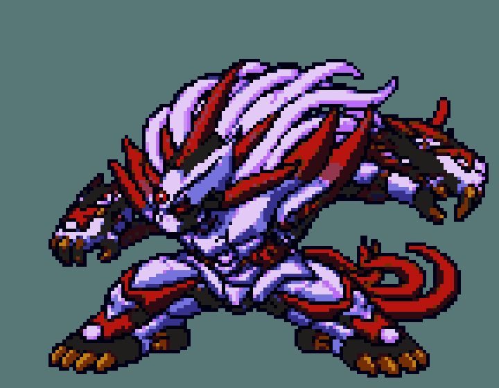

# v003 — four-frame combo loop and redesigned pursuit

Exactly10 unique native sprites.03–06 form a repeatable **windup → left hit → counter-windup → right hit** loop, rather than spending each drawing once.07 rises with a compact uppercut,08 dives diagonally down-left.01/02 and the approved09/10 palm ending are copied byte-for-byte from v002.

[Slow combo](combo-loop-slow.gif) · [Complete moveset demonstration](moveset-demonstration.gif) · [Ten poses](all-ten-poses.png)

144×112 indexed PNGs, original16-entry palette,15 colours used, opaque teal RGB(88,120,120). Nearest-neighbour previews in previews/, indexed BMPs in bmp/. No opponent or effects. Red eyes explicitly palette-locked. Head and legs remain identical across03–06 outside the documented arm/head mask. Full-demo loop count is adjustable (default4 cycles); repeating the four drawings does not introduce extra unique sprites.

Built-in image_gen, repository pixel-looks workflows; same native grid, no illustration resize. One uppercut source was too tall112rows; regenerated into98rows without rescaling body or changing native canvas. Strict master-fit records and all height warnings retained in specification.json. Height warnings reflect low stance and aerial poses and still require visual review, not automatic approval. Default pose reader had a contracted-bounds statistics error; external runtime wrapper fixes only its comparison array after art extraction. Its partial-change merge also retained withdrawn-arm remnants; the final changed-arm region is read on the SAME passed lattice with the repository sampler/key-cleaner/outline rules, then original03 head/legs are restored outside a documented mask. Strict fit threshold is unchanged; no failed gate bypass or different art pipeline. Repository/editor source untouched. Processing sources, prompts and wrappers retained.

The full GIF is a condensed staging demonstration, not literal60fps source-video reconstruction. Two aerial drawings cannot show every hidden attack between camera cuts. No game-import compatibility claim; previous revisions preserved.

## Height review flags

- `native/03-combo-chamber-left.png`: the new view's body is 92 rows tall, the master's 101: it is not the same height; generate again
- `native/07-rising-launch.png`: the new view's body is 97 rows tall, the master's 101: it is not the same height; generate again
- `native/08-diving-followthrough.png`: the new view's body is 70 rows tall, the master's 101: it is not the same height; generate again
- Inherited `native/01-ready-guard.png`: the new view's body is 99 rows tall, the master's 101: it is not the same height; generate again
- Inherited `native/09-palm-charge.png`: the new view's body is 99 rows tall, the master's 101: it is not the same height; generate again
- Inherited `native/10-palm-release.png`: the new view's body is 97 rows tall, the master's 101: it is not the same height; generate again

Lineup verdict=differs:01=99,02=101,03=92,04=92,05=92,06=92,07=97,08=70,09=99,10=97 versus standing master101. firstDrawingDiffers=01,03,04,05,06,07,08,09,10. Four combo poses all92; no central-column height drift between them. Low stance/flight pose flags retained for visual review. Full record:processing/lineup/lineup.json.
