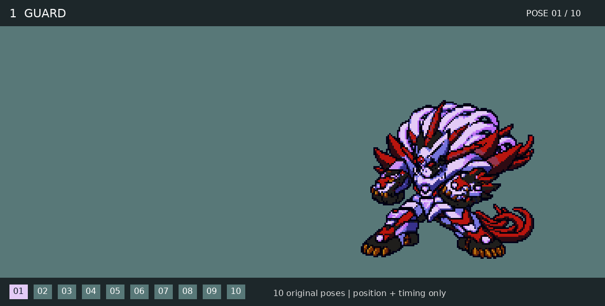

# v004 — kick, grounded uppercut, repeated punches, palm finish

For visual review.10 unique sprites. **Dash →07 low forward kick →08 grounded uppercut →03/04/05/06 left/right punch loop ×4 →09/10 palm finish**.

[Slow sequence](moveset-demonstration-slow.gif) · [Four-pose punch loop](combo-loop.gif) · [All10 sprites](all-ten-poses.png) · [03/04 exact right-guard comparison](comparisons/03-04-right-guard.png)

04 preserves03's right gauntlet pixels exactly inside native box[14,51,48,76), while the left punch passes below.07 is a low forward kick and08 a grounded uppercut based on the supplied pose screenshots.01/02/03/05/06/09/10 native PNGs are byte-identical to v003; the accepted palm ending is unchanged.

Native PNGs:144×112, indexed original16-entry palette,15 used colours including opaque teal RGB(88,120,120). Sixfold nearest-neighbour PNG previews and indexed BMPs included. Red eyes retained. No opponent, effects, HUD or scenery. Original sources and previous versions retained. Generated sources/prompts and processing wrappers are archived; private video screenshots are not redistributed.

Built-in image generation using the repository pixel-looks master/grid workflow, followed by native lattice extraction, palette lock and protected pixel restoration. No high-resolution illustration downscaling. Strict lattice fits:04=0.6922;07=0.9115;08=0.8551. Default pose reader statistics fails on contracted silhouettes; runtime-only comparison padding fixes the statistics. Complete changed-arm sampling uses the same verified lattice, key cleaner and outline rules to avoid stale arm remnants; no repository/editor source was changed. One extra04 generation produced an additional limb and was rejected and archived.

Height review remains flagged: standing master101 occupied rows; kick85, uppercut97, crouched punch poses92. The lineup verdict is `differs`, not a blanket pass. Low pose height is retained for visual review. Numeric checks establish file/palette/guard integrity, not automatic artistic approval. See specification.json and processing/lineup/lineup.json for dimensions and bounds.

Both GIFs were decoded and checked over all118 time intervals against intended renders. Whole-sprite positions use integer pixels; poses snap without morphing. Normal sequence5.9s, slow11.8s. Finish-to-start is an inspection replay reset. Game-import compatibility has not been verified.
