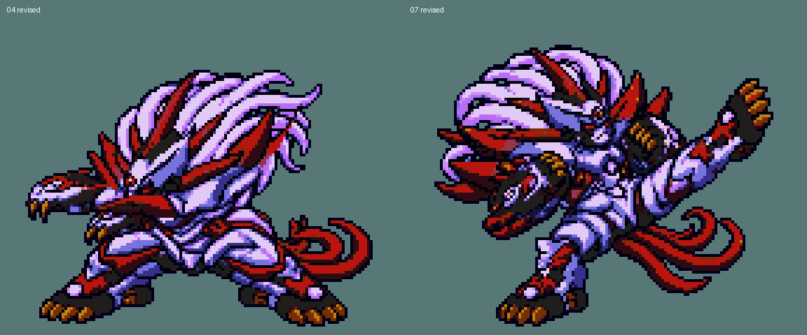
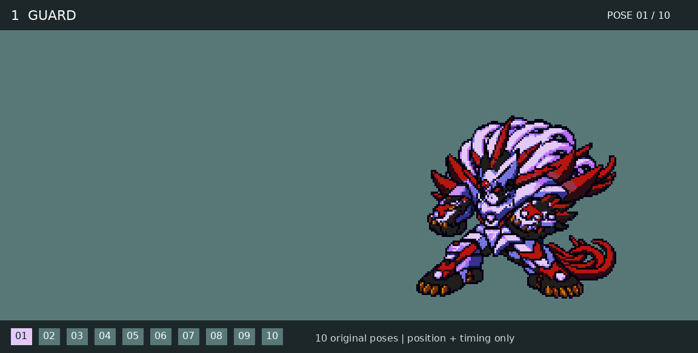

# v005 — long punch with lower-face occlusion; left upward-right kick

For visual review.04 restores the longer left punch fromv003 and raises the forearm to overlap the lower head. The right guard is drawn back relative tov004, remains in front of the body and is partly hidden by the extended left arm.07 now kicks with the anatomical LEFT leg toward IMAGE UPPER RIGHT; right leg supports. Other8 native PNGs, including08 uppercut and09/10 palm finish, are byte-identical tov004.

[Slow sequence](moveset-demonstration-slow.gif) · [Punch loop](combo-loop.gif) · [All10 sprites](all-ten-poses.png)

Sequence: dash → left upward-right kick → grounded uppercut → four-pose left/right punch loop ×4 → palm finish. Native indexed PNG144×112, original16-entry palette (15 colours used), opaque teal RGB(88,120,120).6x nearest-neighbour PNG and indexed BMP included. No opponent or effects. Red-eye colour retained; native sources and all earlier versions preserved.

Art route: built-in image_gen; repository pixel-looks ask-pose/pose for04 and ask-view/view beside original master for07. Native lattice extraction, original-palette mapping and protected-pixel restoration; no high-resolution illustration reduction. Strict final master match04=0.8002,07=0.9541.07 height101 matches standing master101 with no extraction height warning. A chained04 attempt failed52–53percent master matching and was rejected; final04 was regenerated from the original long-punch reference. Runtime comparison-only fix and full changed-arm sampling followv004, with explicit lower-face occlusion area. Repository/editor source unchanged.

Lineup verdict remains `differs`:01=99,03/04/05/06=92,08=97,09=99,10=97 versus standing101 (tolerance1).02/07=101. These crouched/posed drawings remain subject to visual review. Numerical file checks are not artistic approval. Complete records and bounds are in specification.json and processing/lineup/lineup.json.

Both demonstration GIFs were decoded over all118 tick intervals and matched intended renders; punch GIFs have4 checked frames. Normal5.9s, slow11.8s. Integer whole-sprite staging, no pose morphing; finish-to-start is an inspection replay reset. Game-import compatibility unverified.
