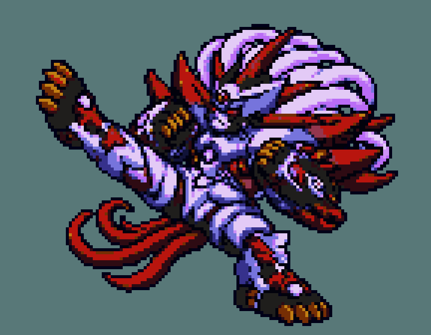

# v006 — mirrored kick facing left

07 is an exact horizontal reflection ofv005, as requested. Robot faces image-left; raised foot now points upper-left. This mirrors the entire pose, rather than redesigning anatomical left/right limbs. Nine other native sprites are byte-identical tov005, including04.

[Updated sequence GIF](moveset-demonstration.gif) · [Slow GIF](moveset-demonstration-slow.gif) · [All10 poses](all-ten-poses.png)

144×112 indexed native PNG, original16-entry palette and15 used colours, opaque teal RGB(88,120,120). Eyes/colours and every source pixel are preserved by exact reflection.6x nearest previews and indexed BMP included. No generation, repainting or resampling was needed. Earlier versions/source art remain intact; seev005 for generation provenance.

Verified reflection pixel equality, unchanged palette, nine other native file hashes, and normal/slow GIF decode against all118 intended time intervals.07 height101 still matches standing master101. Lineup verdict remains `differs` for inherited posed heights:01=99,03–06=92,08=97,09=99,10=97 versus101(tolerance1). These flags remain for visual review; no blanket art approval. Stage uses integer translation and held poses, no effects/opponent. Finish-to-start is a replay reset. Game import compatibility unverified.
