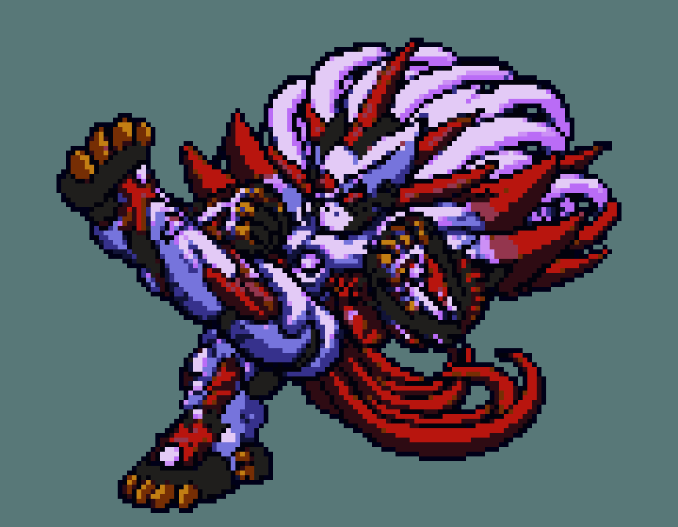
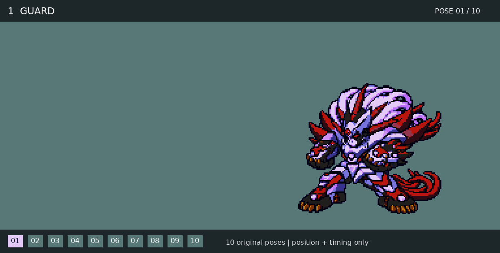

# v007 — body-relative cross-body rising kick, latest04 punch

07 regenerated from the original unmirrored standing master: anatomical left leg crosses the body and rises to the robot's own right-front-up space in front of its head. Robot remains facing image-left, mane/rear ribbons flow image-right. This is a new pose, not a horizontal mirror. For visual review.

[Slow animation](moveset-demonstration-slow.gif) · [Latest04 punch](previews/04-combo-left-hit-6x.png) · [All10 poses](all-ten-poses.png)

04 uses the latestv005 long-punch drawing, with lower-face occlusion and the partially hidden retracted guard. Its native PNG is confirmed byte-identical tov005. All9 other sprites are byte-identical tov006. Sequence: dash → revised kick → grounded uppercut → four-pose punch loop ×4 → palm finish. No opponent or effects.

144×112 indexed native PNG, original16-entry palette,15 used colours, opaque teal RGB(88,120,120). Red eye preserved; nearest6x preview and indexed BMP included. Original sources and all prior versions retained. Built-in image_gen with repository ask-view/view ruler workflow, measured native lattice extraction and original-palette lock; no illustration resizing and no repository/editor source edits. Strict ruler match0.9621.

Extraction warning retained verbatim: "the new view's body is85 rows tall, the master's101: it is not the same height; generate again" (spaces in the machine record are authoritative). Overall occupied kick bounds are120×101; the narrow foot-column body measurement is85 due to the angled cross-body stance. Lineup verdict `differs`:01=99,03–06=92,07=85,08=97,09=99,10=97 versus standing101(tolerance1);02=101. These remain visual-review flags; numerical checks are not automatic art approval. See processing/07/extracted/pose-07.json and processing/lineup/lineup.json.

Normal5.9s and slow11.8s GIFs were decoded over all118 intended tick intervals and matched intended renders. Integer whole-sprite staging, no pose morphing. Finish-to-start is an inspection replay reset. Game-import compatibility unverified.
