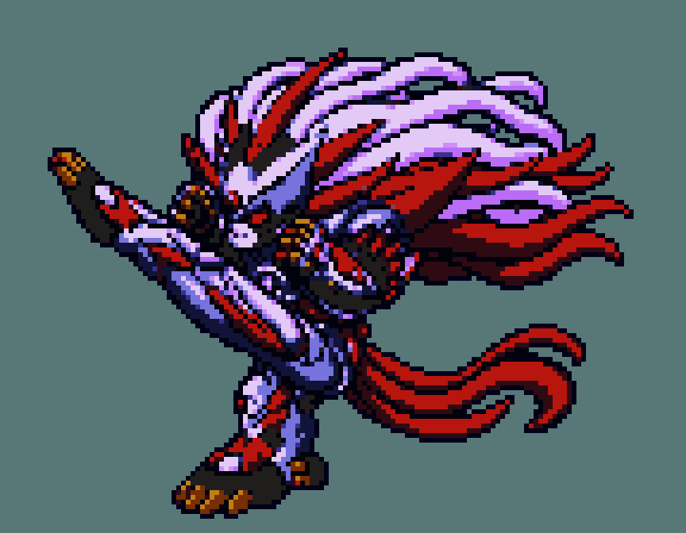
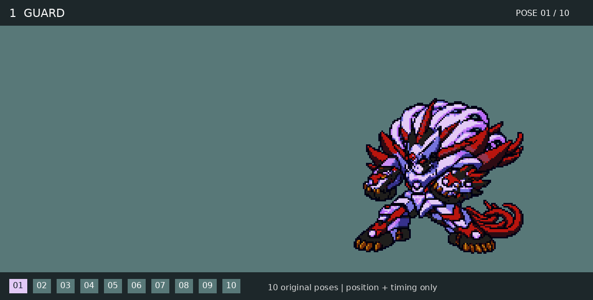

# v008 — forward upper body, far-side rising kick

07 revised for visual review: torso leans forward rather than backward. The left thigh, knee, shin and toes turn together toward the robot-relative right-up direction, away from the camera. Foot uses side armour/profile rather than a broad sole facing the screen. Original left-facing character orientation, body palette and red eyes retained.

[Slow animation](moveset-demonstration-slow.gif) · [Latest04 punch](previews/04-combo-left-hit-6x.png) · [All10 poses](all-ten-poses.png)

Latest04 is byte-identical tov005 long-punch/lower-face-occlusion artwork. All9 other native sprites are unchanged fromv007. Sequence: dash → revised kick → grounded uppercut → left/right punch loop ×4 → palm finish. No opponent/effects.144×112 indexed native PNG, original16-entry palette,15 used colours, opaque teal RGB(88,120,120),6x nearest PNG and indexed BMP.

Built-in image_gen edit, repository pixel-looks ruler/lattice extraction, original-palette mapping and red-eye lock. No illustration resizing or source-code edits. Source, prompt and extraction records preserved; all previous versions retained. Game-import compatibility unverified.

Extraction warnings (verbatim):

- the new view's body is 96 rows tall, the master's 101: it is not the same height; generate again

Lineup verdict: differs. Standing body height101, tolerance1. Full per-file height flags are retained in processing/lineup/lineup.json; crouched/rotated poses require visual review rather than automatic approval.

Both full GIFs decoded and compared over all118 intended tick intervals. Normal5.9s, slow11.8s; integer whole-sprite movement with held key poses. Finish-to-start is an inspection replay reset.
