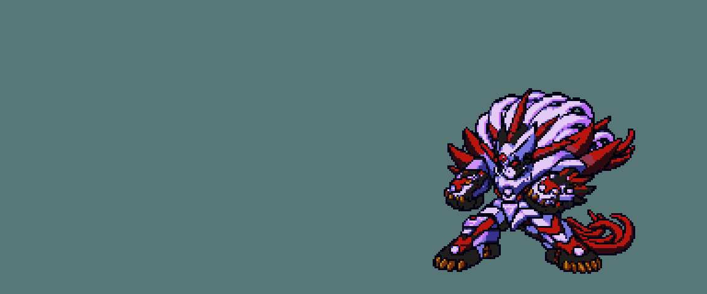

# Video rebuild —30 poses, v001

A newly planned30-drawing moveset from the six-part video and approved base mecha.22 new pose designs;8 suitable key poses retained/adapted with user authorization (6 whole-sprite exact copies,2 existing punch-arm endpoints adapted to the shared base-derived combat body). This is separate from the earlier thirty-sprites/v001 collection. No previous aerial spin-followup cycle is reused.

[Slow15.9s](moveset-30-slow.gif) · [Numbered7.95s](moveset-30-labelled.gif) · [All30 poses](all-30-poses.png) · [30native PNG ZIP](mecha-30-native-only.zip) · [PNG/previews/BMP bundle](mecha-30-individual-sprites.zip)

New sequence: guard/gather power → load/rush → short alternating close-combat block → plant/knee chamber/turning kick → back-facing landing/unwind → uppercut/rising followthrough → coiled aerial pursuit, alternating lead/counter attacks → descending pursuit/recovery/landing → palm reset/windup/drive/hit/followthrough → guard recovery. The5-drawing ground combination repeats2times; the2-drawing airborne attack exchange repeats2times. Holds/repetitions are not counted as extra drawings.

Native PNGs are individually numbered01–30 in native/, each144×112 with the original16-entry palette,15 used colours, fully opaque teal RGB(88,120,120).6x nearest previews and indexed BMPs included. Red eyes explicitly locked; gauntlets remain armoured mechanical shells with original claws. No opponent, beam, aura, impact flash, scenery or UI inside sprites. Prior versions and reference files preserved.

Built-in image_gen and the documented pixel-looks master-ruler workflow: each new pose is generated beside the original approved standing ruler, measured with strict lattice fitting and sampled to1x, then mapped to the original palette. No high-resolution illustration shrinking.23 generation attempts produce22 retained new pose designs; the first half-punch with an oversized gauntlet was rejected and replaced by an edit from the new chamber pose. Sources/prompts/grid records retained under processing/. Five ground-combat poses share protected base-derived head/legs and integer-aligned arm artwork to avoid body flicker; original arm pixels and component restoration are documented. No editor or repository source code changed; no paid APIs.

This is a condensed character-only interpretation, not a literal shot-by-shot or60fps reproduction of the entire clip. Dark video grading, closeup/camera cuts and long effect-only holds are omitted; hidden limb positions require interpretation. Normal7.95s, slow15.9s. Stage384×160 displayed3x nearest. Whole-sprite positions move in integer pixels; held drawings snap, without morphing. Last-to-first is an inspection replay reset. Native-grid simplification loses some tiny generated bevels/claw highlights. Game-import compatibility unverified.

30 different native pixel drawings, original palette/canvas, exact6x previews and all159 intended intervals of3GIFs checked. File checks do not constitute artistic approval; this version is for review. The baseline palette/layout stays fixed, while projected height changes in coiled/airborne poses. Some extended mane/attack poses use up to111 of112canvas rows; no source pixels were clipped or resized.

## Height review records

Standing body's reference height101rows, lineup tolerance1row. `lineup` verdict: `differs`. Exact per-file measurements are in processing/lineup/lineup.json and qa-report.json; frames06–10 share a consistent92-row combat build. New source extraction warnings are retained verbatim:

- 04 (native/04-launch-load.png): the new view's body is 78 rows tall, the master's 101: it is not the same height; generate again
- 05 (native/05-dash-drive.png): the new view's body is 80 rows tall, the master's 101: it is not the same height; generate again
- 06 (native/06-left-chamber.png): the new view's body is 95 rows tall, the master's 101: it is not the same height; generate again
- 07 (native/07-left-cross-half.png): the new view's body is 95 rows tall, the master's 101: it is not the same height; generate again
- 11 (native/11-kick-step.png): the new view's body is 96 rows tall, the master's 101: it is not the same height; generate again
- 14 (native/14-turn-landing.png): the new view's body is 94 rows tall, the master's 101: it is not the same height; generate again
- 15 (native/15-unwind-coil.png): the new view's body is 88 rows tall, the master's 101: it is not the same height; generate again
- 16 (native/16-uppercut-load.png): the new view's body is 97 rows tall, the master's 101: it is not the same height; generate again
- 18 (native/18-uppercut-rise.png): the new view's body is 85 rows tall, the master's 101: it is not the same height; generate again
- 19 (native/19-airborne-coil.png): the new view's body is 87 rows tall, the master's 101: it is not the same height; generate again
- 20 (native/20-airborne-lead-hit.png): the new view's body is 105 rows tall, the master's 101: it is not the same height; generate again
- 22 (native/22-downward-pursuit.png): the new view's body is 83 rows tall, the master's 101: it is not the same height; generate again
- 23 (native/23-air-recovery.png): the new view's body is 89 rows tall, the master's 101: it is not the same height; generate again
- 24 (native/24-landing-absorb.png): the new view's body is 106 rows tall, the master's 101: it is not the same height; generate again
- 25 (native/25-palm-reset.png): the new view's body is 104 rows tall, the master's 101: it is not the same height; generate again
- 27 (native/27-palm-drive-half.png): the new view's body is 99 rows tall, the master's 101: it is not the same height; generate again
- 29 (native/29-palm-followthrough.png): the new view's body is 71 rows tall, the master's 101: it is not the same height; generate again

Capability doctor: optional API credentials, video-generation route and SVG renderer missing; these were not used. Host image generation, supplied-clip inspection and PNG/GIF processing were available. Original clips/stills are private and not redistributed; video-reference.json records provenance.
