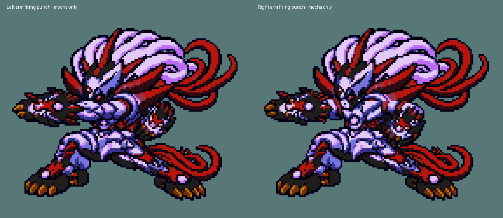

# Alternating left/right firing punches — v001

Two mecha-only poses based on approved Candidate 2. The video supplies the gestures only. Both sprites retain the **original base colours**, with no copied dark/red video lighting and no light-wave/beam effects.

| Pose | Native PNG | 6× preview | Indexed BMP |
| --- | --- | --- | --- |
| Anatomical left arm firing across chest | [PNG](left-punch-1x.png) | [Preview](left-punch-6x.png) | [BMP](left-punch.bmp) |
| Anatomical right arm firing, left arm retracted | [PNG](right-punch-1x.png) | [Preview](right-punch-6x.png) | [BMP](right-punch.bmp) |

Both aim toward the viewer's left from the same camera. The second pose is an arm swap, not a mirrored character. Head, legs and trailing strands are pixel-identical between the pair outside the documented arm/chest edit regions.

Each native PNG is **144 × 112**, indexed with the approved **16-entry palette** (15 entries used) and opaque teal **RGB (88,120,120)**. Previews use exact 6× nearest-neighbour. Original angular gauntlet identity is retained instead of a human fist design.

[Processing report and retained height warnings](report.txt) · [Specifications](specification.json)

The video and extracted screenshots remain in the workspace and are not republished here. No animation or game-import compatibility claim.
