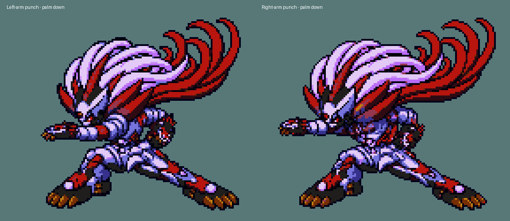

# Alternating firing punches — reworked v002

Reworks the rejected v001 poses using the user's latest corrections:

- Strong forward upper-body tilt, with the head ahead of the hips.
- Punch stays **horizontal** with a **straight wrist and palm facing downward**; the hand is not bent downward.
- Shorter reach and smaller original-design angular gauntlet; no human knuckle fist.
- Inactive arm bends back beside the ribs.
- All loose strands sweep up behind the head; **no hair behind the feet**.
- Original bright base palette; video dark/red lighting is excluded.
- Mecha poses only; no 光波, beam or other effects.

| Pose | Native PNG | 6× preview | Indexed BMP |
| --- | --- | --- | --- |
| Left arm active | [PNG](left-punch-1x.png) | [Preview](left-punch-6x.png) | [BMP](left-punch.bmp) |
| Right arm active | [PNG](right-punch-1x.png) | [Preview](right-punch-6x.png) | [BMP](right-punch.bmp) |

Both aim toward viewer-left from the same camera, rather than mirroring the whole character. Each PNG is **144 × 112**, indexed with the approved **16-entry palette**; actual used counts are in [specification.json](specification.json). Background is opaque teal **RGB (88,120,120)**. Previews are exact 6× nearest-neighbour. This is a new model-assisted posed revision, not a claim of pixel-identical body parts between the pair. Earlier versions remain untouched.

[Method and retained workflow warnings](report.txt). No game-import compatibility claim.
