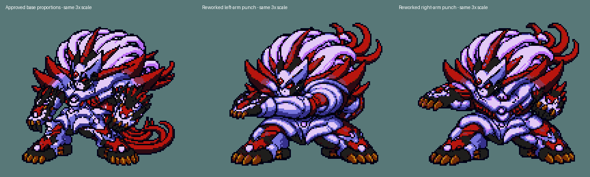

# Firing punches — v003 body-build revision

Reworks the thin/long-limbed v002 toward approved Candidate 2's heavy compact build: broader chest and shoulders, a substantial layered waist/pelvis, shorter thicker bent legs and larger clawed feet. The pose is a forward lean of a solid torso, rather than a stretched slim humanoid.

[Left native PNG](left-punch-1x.png) · [Left 6× preview](left-punch-6x.png) · [Right native PNG](right-punch-1x.png) · [Right 6× preview](right-punch-6x.png)

The near left arm crosses in front of the chest; the far right-arm variant reveals more of the chest. Both keep horizontal palm-down punches, original angular gauntlet identity, a naturally retracted inactive arm, upper-swept strands with none behind the feet, original bright palette, and no 光波 or effects.

Native 144×112 indexed PNGs, exact original 16-entry palette, opaque teal RGB(88,120,120). Actual used counts are recorded in specification.json. Previews are exact 6× nearest-neighbour; indexed BMPs included. Body and pose fidelity require visual review, not automatic numeric acceptance. Prior revisions are retained.

[Method and retained warnings](report.txt) · [Specifications](specification.json)
