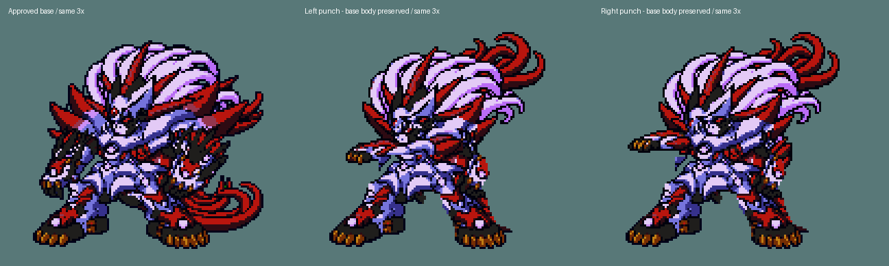

# Firing punches — v004, base-body preservation

Edits start from the approved Candidate 2 sprite itself, rather than using thin v002 or over-bulky v003 as body guides. Original central torso, waist and masked leg/foot pixels are restored directly from the base at their original positions. Upper body is reposed without a global thickness stretch.

[Left native PNG](left-punch-1x.png) · [Left 6x preview](left-punch-6x.png) · [Right native PNG](right-punch-1x.png) · [Right 6x preview](right-punch-6x.png)

144×112 indexed PNGs, original 16-entry palette, opaque teal RGB(88,120,120), exact nearest-neighbour previews and indexed BMPs. No beam/effects. Hair is gathered behind head, not behind feet. Horizontal punches have palm facing down, with a forward torso lean and retracted inactive arm. Original base stance is prioritized over the video's wider lunge to avoid distorting the body.

The upper body remains model-assisted reposing, not a claim of identical upper-body pixels or certified perfect proportions. [Workflow limitation and method](report.txt) · [Specifications](specification.json). No game-import compatibility claim.
