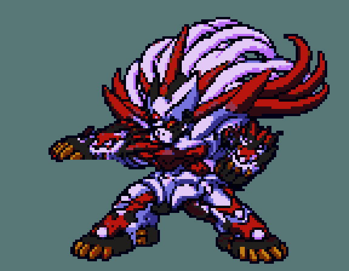

# Alternating punch loop — v005

Exactly **two sprites** built to alternate **A → B → A → B**: left-arm punch/right-arm recovery, then right-arm punch/left-arm recovery. A common forward-leaning body is retained so the stance, head, hips, feet and hair do not jump. Arm/shoulder/chest overlap pixels carry the exchange. Forearms are reworked toward the original base thickness, rather than the thin v004 arms.

[Slow inspection loop](alternating-preview-slow.gif) · [Two-frame comparison](two-frame-comparison.png) · [Equal-scale base comparison](base-and-loop-frames.png)

| Frame | Native PNG | 6× preview | Indexed BMP |
| --- | --- | --- | --- |
| A: left punch | [PNG](frame-A-left-punch-1x.png) | [Preview](frame-A-left-punch-6x.png) | [BMP](frame-A-left-punch.bmp) |
| B: right punch | [PNG](frame-B-right-punch-1x.png) | [Preview](frame-B-right-punch-6x.png) | [BMP](frame-B-right-punch.bmp) |

144×112 indexed PNGs, exact original 16-entry palette, opaque teal RGB(88,120,120). Actual used counts are recorded in specification.json. Preview scaling is integer nearest-neighbour. Both punches remain horizontal with palm down, original armoured gauntlet identity and no beam/光波 effects. All lower loose hair has been omitted, strands sit behind/up from head.

GIFs are diagnostic previews made from the same two PNGs; no additional animation frames or runtime sprite sheet. Preview speed is adjustable: 140ms per pose (normal), 260ms (slow); both repeat indefinitely. Two-frame motion necessarily snaps between extension and retraction; no interpolation or unrequested extra sprites are claimed. Body/gauntlet anatomy still requires visual user review, not automatic approval. Original base is unchanged; no game-import compatibility claim.

[Method and checks](report.txt) · [Specifications](specification.json)
