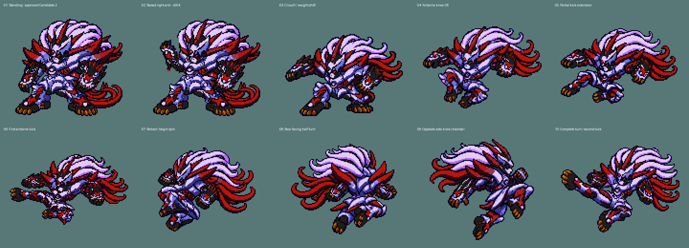

# Complete mecha pose sequence (v001)

All **10 selected poses**, from the approved standing base through the raised right arm, first airborne kick, full turn and follow-up kick, collected in one commit and folder. Every sprite, preview and BMP is a byte-identical copy of its existing selected source; no artwork or palette changed. Superseded human-fist and open-claw trials remain in their original historical folders and are not mixed into this selected sequence.

[Download the complete collection as a ZIP](all-10-poses.zip) · [Native PNGs](native/) · [6× previews](previews-6x/) · [Indexed BMPs](indexed-bmp/) · [Source paths and checksums](manifest.json)

| Order | Pose | Native PNG | Enlarged preview |
| --- | --- | --- | --- |
| 01 | Standing - approved Candidate 2 | [PNG](native/01-standing.png) | [6×](previews-6x/01-standing.png) |
| 02 | Raised right arm - v004 | [PNG](native/02-right-fist-up.png) | [6×](previews-6x/02-right-fist-up.png) |
| 03 | Crouch / weight shift | [PNG](native/03-kick-transition-1.png) | [6×](previews-6x/03-kick-transition-1.png) |
| 04 | Airborne knee lift | [PNG](native/04-kick-transition-2.png) | [6×](previews-6x/04-kick-transition-2.png) |
| 05 | Partial kick extension | [PNG](native/05-kick-transition-3.png) | [6×](previews-6x/05-kick-transition-3.png) |
| 06 | First airborne kick | [PNG](native/06-airborne-kick.png) | [6×](previews-6x/06-airborne-kick.png) |
| 07 | Retract / begin spin | [PNG](native/07-spin-kick-1.png) | [6×](previews-6x/07-spin-kick-1.png) |
| 08 | Rear-facing half-turn | [PNG](native/08-spin-kick-2.png) | [6×](previews-6x/08-spin-kick-2.png) |
| 09 | Opposite-side knee chamber | [PNG](native/09-spin-kick-3.png) | [6×](previews-6x/09-spin-kick-3.png) |
| 10 | Complete turn / second kick | [PNG](native/10-spin-kick-4.png) | [6×](previews-6x/10-spin-kick-4.png) |

All native images are **144 × 112 indexed PNGs**, with the same **16-entry palette** and opaque teal **RGB (88, 120, 120)**. Standing and raised-arm sprites use all 16 entries; later action poses use 15 of those entries. Previews are exact 6× nearest-neighbour enlargements. Each BMP reproduces its PNG's RGB pixels.

The overview is for browsing, not a runtime sprite sheet. Animation timing, root registration and game-import compatibility are not established. Detailed generation methods, reference material and QA warnings remain in the original source folders linked by `manifest.json`. Original files and prior commits are retained.
