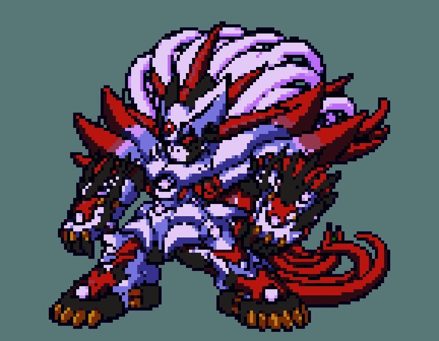

# Mecha — approved Candidate 2 (v001)

User-selected static sprite. The newest supplied proportion guide establishes the compact head/body ratio; the standing mecha illustration establishes character identity. Reference A establishes the small in-game pixel-art style and native format. The inline proportion guide is retained in the originating chat; its original bytes were not available as a local file.

| Property | Verified value |
| --- | --- |
| Native canvas | 144 × 112 pixels |
| Occupied area | 112 × 102 pixels |
| Bounds, right/bottom exclusive | (16, 7)–(128, 109) |
| PNG mode | Indexed colour (P) |
| Stored / used palette entries | 16 / 16 |
| Background | Opaque teal, RGB (88, 120, 120), palette index 0 |
| Enlarged preview | 864 × 672, exact 6× nearest-neighbour |

## Files

- [Native PNG](mecha-final-1x.png)
- [6× preview](mecha-final-6x.png)
- [Indexed BMP](mecha-final-indexed.bmp), matching the native PNG's RGB pixels
- [Reference A / final / Reference B comparison](reference-a-final-reference-b.png)
- [Machine-readable specification](specification.json)
- [Original style and identity references](references/)
- [Selected generated source, extraction and workflow record](processing/)

## Processing

Art source: built-in host `image_gen`; no external paid generation API was invoked. The exact image model and monetary cost were not exposed. The repository's `generate2dsprite` pixel-looks `ask-cast`/`cast` workflow used a lossless PNG of Reference A directly as the native ruler, with only background index 0 made transparent for the intermediate ruler.

The stock 1536 × 1024 layout could not fit the 98-pixel-wide ruler at the minimum 8-pixel cell size. A runtime wrapper used a 2048 × 1024 intermediate layout without editing repository or editor source. The model returned 1774 × 887. The existing fitter's search was narrowed to `spread=0.15`, `reach=6`; strict nine-point comparison and the rejection gate remained enabled. The actual measured cell size was 6.93 source pixels, with 84.99% ruler-cell agreement.

`cast` read the new character on its own lattice, cleaned keyed edges, closed the dark outline, and reduced the foreground to 15 colours. The extracted cells were padded onto the native canvas without resizing; exact teal was then added as the sixteenth palette entry. All decoded alpha values are 255. Workflow warnings were empty; artistic acceptance came from the user's selection, not numerical checks alone.

The new silhouette is 14 pixels wider and 3 pixels shorter than Reference A's 98 × 105 occupied area. Grouped claw digits, compressed waist plates and reduced face/vent detail are unavoidable simplifications in this version. This is model-assisted pixel art, not original hand-authored game art.

The references are supplied study material; their inclusion does not establish redistribution or commercial-use rights. No ROM, disc image, existing game file or editor source was modified. Game-import compatibility has not been verified. This directory contains one static sprite and its supporting artifacts; no animations or sprite sheets.
